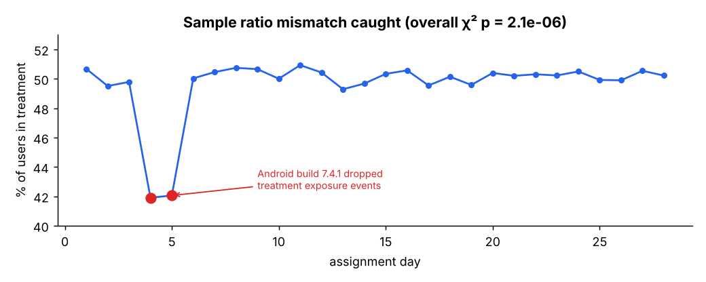
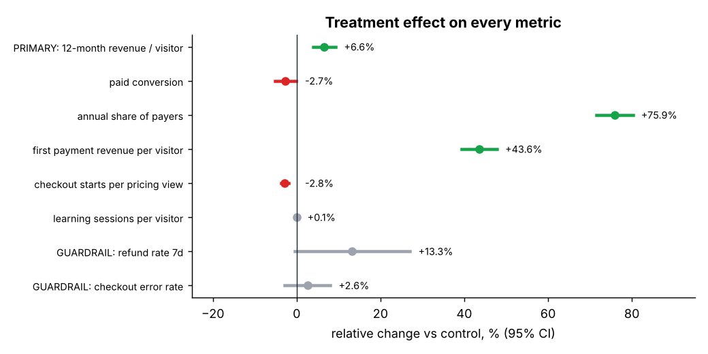
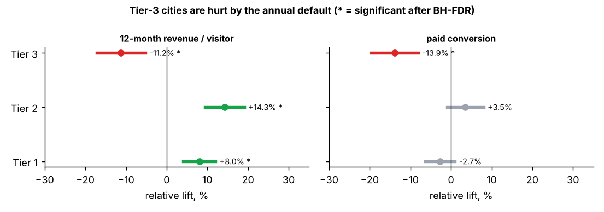
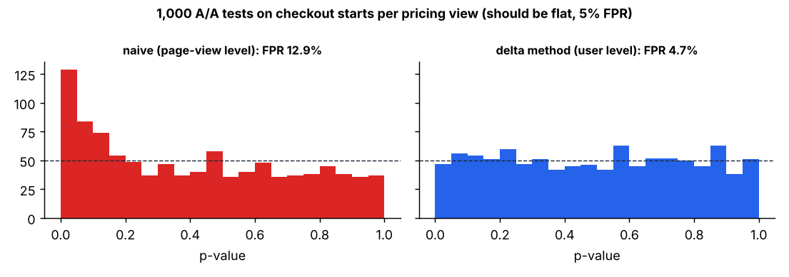
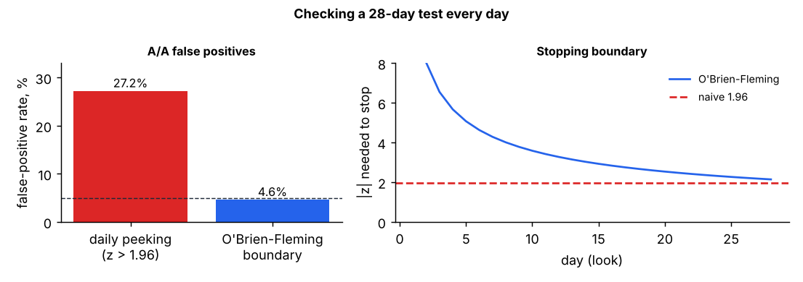

# ShipOrSkip: A/B Testing Engine + Pricing Experiment Case Study

A small, **tested** Python toolkit that analyses an online experiment the way a growth or data-science team at a product company would. It's applied end-to-end to a 515K-visitor pricing-page test for *Padho*, a fictional exam-prep subscription app.

It goes beyond "run a t-test":

| Problem real experiments hit | What ShipOrSkip does |
|---|---|
| Broken assignment or logging silently biases results | **SRM gate**: χ² test, refuses to read metrics if p < 0.001, drills down by day/platform to find the broken slice |
| Ratio metrics (clicks per page view) get falsely significant | **Delta method** variance at the user level (randomisation unit ≠ analysis unit) |
| Tests take too long to reach significance | **CUPED** variance reduction using pre-experiment data |
| Revenue is heavy-tailed | Welch test + **bootstrap CI** |
| "Ship it, conversion only dropped a little" | **Guardrails as non-inferiority checks** (worst plausible value must stay within the margin) |
| Slicing 16 segments finds something by chance | **Benjamini-Hochberg FDR** correction on segment results |
| PMs check results every day | **O'Brien-Fleming** sequential boundaries + a peeking simulation |
| "How long do we need to run it?" | **Power / sample-size / MDE** calculators (with CUPED adjustment) |

The output is a decision (`SHIP`, `SHIP WITH CONDITIONS`, `DO NOT SHIP`, `NO DECISION`, `INVALID`) plus an auto-generated Markdown decision memo.

> **Data note.** The experiment data is **simulated** by `case_study/generate_experiment.py` with known ground truth: a planted Android logging bug, a revenue lift, and a Tier-3 conversion drop. That makes it possible to **prove** the engine recovers the truth, which real data can't do.

**Stack:** Python · NumPy · SciPy · pandas · matplotlib · pytest (13 unit tests)

---

## Case study: should Padho make the Annual plan the default?

**Test:** Control shows Monthly (₹299) first. Treatment pre-selects Annual (₹1,999, "save 44%"). It ran for 28 days with 514,919 visitors.

1. **The engine blocked the first read.** The split was 49.67/50.33 (χ² p = 2.1 × 10⁻⁶). The drill-down found treatment at only ~42% on **days 4-5, Android only**: a buggy app build dropped exposure events. Those visitors were excluded from *both* arms → clean split (p = 0.017).
2. **Primary metric:** projected 12-month revenue per visitor rose **+6.6% (95% CI +3.9% to +9.3%)**. Annual share of payers went from 29% to 52%.
3. **Guardrails at risk:**
   - Paid conversion fell 2.7%, and its CI reaches −5.2%, past the −5% margin.
   - Refunds rose +0.5 pp, with a CI upper bound of +1.03 pp.
   - **Verdict: SHIP WITH CONDITIONS.**
4. **Segments (FDR-corrected):** Tier-1 revenue **+8.0%**, Tier-2 **+14.3%**, Tier-3 **−11.2%**. Tier-3 conversion fell **−13.9%** because of the price shock.
5. **Recommendation:** launch to Tier-1 and Tier-2 only. That's worth about **+₹5.9 lakh per 100K visitors**, **~31% more** than a full rollout, and it protects Tier-3 conversion. Confirm with a follow-up test.

Full memo: [`docs/launch_recommendation.md`](docs/launch_recommendation.md) · Engine output: [`outputs/decision_memo.md`](outputs/decision_memo.md) (and [`decision_memo_raw_data.md`](outputs/decision_memo_raw_data.md), the blocked first read)

| | |
|---|---|
|  |  |
|  |  |

## Validating the engine before trusting it

| Check (1,000 A/A simulations unless noted) | Result |
|---|---|
| False-positive rate, conversion / revenue | 3.7% / 4.2% (target 5%) |
| Ratio metric: naive page-view test vs **delta method** | **12.9%** vs **4.7%** |
| Peeking daily for 28 days: naive vs **O'Brien-Fleming** (20K sims) | **27.2%** vs **4.6%** |
| CUPED on engagement metric | **49%** variance removed → **~half the sample size** for a 2% MDE (29.9K vs 59.1K per arm) |
| CUPED on revenue | 0.6%: 70% of visitors are new, so there's no useful pre-period covariate. Reported, not hidden. |



---

## Use it on your own experiment

```bash
pip install -r requirements.txt
python -m shiporskip --data case_study/data/pricing_test.csv.gz --config case_study/config.json \
    --exclude "platform == 'android' and assign_day in [4, 5]" --out outputs
```

A JSON config declares the primary, secondary and guardrail metrics (`proportion`, `mean` with optional `cuped_covariate`, or `ratio` with `num`/`den`), the guardrail margins, and the segments. See [`case_study/config.json`](case_study/config.json).

```python
from shiporskip import srm_test, two_proportion_ztest, cuped_pooled, delta_method_ratio, n_per_arm_proportion
n_per_arm_proportion(p0=0.044, mde_abs=0.003)     # users per arm to detect +0.3 pp
```

## Project structure

```
shiporskip/
  stats.py        z-test, Welch, delta method, bootstrap, Benjamini-Hochberg
  srm.py          sample ratio mismatch test + drill-down
  cuped.py        CUPED variance reduction (pooled theta)
  power.py        sample size / MDE
  sequential.py   O'Brien-Fleming boundaries, peeking simulation
  analyze.py      config-driven pipeline + decision rules
  report.py       Markdown decision memo
  __main__.py     CLI
case_study/
  generate_experiment.py   simulated pricing test with planted ground truth
  config.json              metric definitions + guardrail margins
  validate_engine.py       A/A, delta-method, CUPED, peeking checks
  run_case_study.py        end-to-end: data → analysis → validation → charts → memos
tests/test_shiporskip.py       13 unit tests (incl. matches scipy, CI coverage, BH, OBF = 1.96 at 1 look)
docs/launch_recommendation.md
outputs/                   charts, analysis.json, validation.json, decision memos
```

```bash
python case_study/run_case_study.py   # ~30 s, regenerates everything
pytest -q
```
